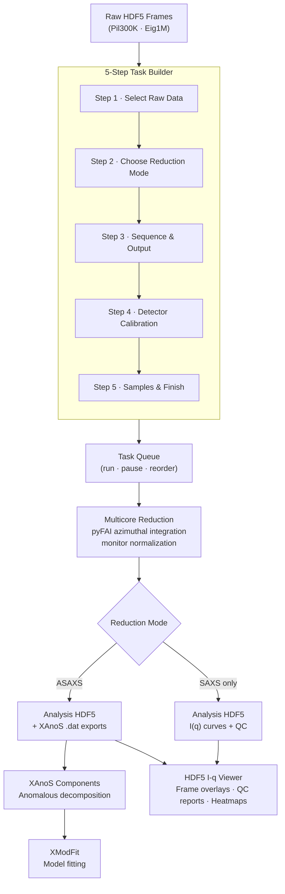

# FrameByFrame

**FrameByFrame** is a GUI-driven data reduction platform for SAXS, WAXS, and ASAXS experiments at ChemMatCARS (Sector 15, Advanced Photon Source). It turns raw synchrotron detector frames into analysis-ready I(q) curves through a guided five-step wizard, then links directly to XAnoS for anomalous scattering decomposition and XModFit for model fitting.

---

## End-to-End Workflow



---

## Starting the Application

```
framebyframe-aswaxs
```

The application opens on the **Task Queue** tab. All wizard settings are persisted automatically between sessions.

---

## 5-Step Task Builder

Click **New Task** on the dashboard to open the task builder. Navigate with **Back** and **Next**; click **Add to Queue** on the last step to submit.

### Step 1 — Select Raw Data

```
[ Browse Folder ]  →  auto-discovers Pil300K/ and Eig1M/ subfolders
                       and counts available .h5 frame files

Detector Mode:   ◉ Pil300K only (SAXS)
                 ○ Eig1M only (WAXS)
                 ○ Pil300K + Eig1M (simultaneous)
```

- Paste or browse to an experiment folder; the app scans it asynchronously and reports how many `.h5` files are present per detector.
- **Detector Mode** controls which detector pipelines run. Choose *Both* for simultaneous SAXS/WAXS acquisition.
- Individual HDF5 files can also be selected manually when the folder convention does not apply.

---

### Step 2 — Choose Reduction Mode

```
┌───────────────────────────────┐  ┌───────────────────────────────┐
│  ASAXS / XAnoS                │  │  SAXS Only                    │
│                               │  │                               │
│  [illustration: I(q) curves   │  │  [illustration: single I(q)   │
│   shifting across energies]   │  │   curve on log-log axes]      │
│                               │  │                               │
│  Multi-energy near resonance  │  │  Single-energy azimuthal      │
│  → XAnoS decomposition        │  │  integration                  │
└───────────────────────────────┘  └───────────────────────────────┘
```

Select the card that matches your experiment:

| Mode | When to use |
|------|-------------|
| **ASAXS / XAnoS** | Anomalous SAXS: data collected at 3+ energies near an element's absorption edge. FrameByFrame reduces all energies and exports XAnoS-format `.dat` files for component extraction. |
| **SAXS Only** | Single-energy SAXS or WAXS. Standard azimuthal integration with background subtraction and optional absolute scaling. |

A **Task Name** field at the top of this step names the queue entry.

---

### Step 3 — Sequence & Output

```
Acquisition geometry
  Energies  [ 15 ▲▼ ]     Groups  [ 5 ▲▼ ]     Frames  [ 100 ▲▼ ]

  → Expected input: 7,500 frame files per detector

Monitor normalization PV
  Pil300K monitor key  [ SPDS ▼ ]   [ Scan PVs from HDF5 ]
  Eig1M monitor key    [ WPDS ▼ ]   [ Scan PVs from HDF5 ]

Output folder  [ auto-derived from experiment folder ]  [ Override ]
```

- **Energies / Groups / Frames** spinboxes define the full acquisition structure. The live summary line below them recomputes the total expected frame count as you type.
- **Monitor normalization PV** — choose the beamline intensity monitor channel for flux normalization. Clicking *Scan PVs from HDF5* reads available PV keys directly from a sample file.
- **Output folder** is derived automatically from the raw data location. Override it only when saving results elsewhere.

---

### Step 4 — Detector Calibration

```
Pil300K (SAXS)                      Eig1M (WAXS)
  PONI file  [ path… ] [Browse]        PONI file  [ path… ] [Browse]
  Mask file  [ path… ] [Browse]        Mask file  [ path… ] [Browse]

Common settings
  Sample thickness   [ 1.5  mm ]
  GC thickness       [ 1.0  mm ]
  CPU cores          [ 8       ]
```

- **PONI file** — pyFAI geometry file encoding beam center, sample-detector distance, and detector tilt. Required for accurate azimuthal integration.
- **Mask file** — pixel mask that excludes dead pixels, beamstop shadow, and module gaps.
- A separate PONI and mask are set for each active detector.
- **Common settings** apply to both detectors: sample and glassy-carbon capillary thickness for transmission correction and absolute calibration, plus the CPU core budget for parallel reduction.

---

### Step 5 — Samples & Finish

```
Group role assignments
  GC group     [ 1 ▲▼ ]   Air group   [ 2 ▲▼ ]   Empty group [ 3 ▲▼ ]

Sample / solvent pairs
  ┌─────────────────────┬──────────────┬───────────────┐
  │ Output name         │ Sample group │ Solvent group │
  ├─────────────────────┼──────────────┼───────────────┤
  │ AuNP_10mM_citrate   │      5       │      4        │
  │ AuNP_1mM_citrate    │      6       │      4        │
  └─────────────────────┴──────────────┴───────────────┘
  [ + Add Row ]  [ Visual Rack Builder ]

[ Add to Queue ]
```

- **Group role assignments** map sequence group numbers to their physical meaning. The GC group provides the absolute calibration factor; air and empty groups are used for background correction.
- **Sample / solvent pairs** define which groups constitute a measurement and its background. Each row produces one reduced I(q) output named after the *Output name* column.
- **Visual Rack Builder** — opens a graphical capillary rack layout where you drag and assign roles (Sample, Solvent, GC, Air, Empty, Skip) to physical positions. Assignments feed back into the pair table automatically.

---

## Task Queue

```
┌──────────────────────────────────────────────────────────────────────┐
│ Task name        │ Status  │ Detectors │ Sequence        │ Pairs     │
├──────────────────────────────────────────────────────────────────────┤
│ AuNP_ASAXS_run1  │ Running │ Pil + Eig │ 15E × 6G × 100F │ 2 pairs   │
│ AuNP_SAXS_check  │ Queued  │ Pil only  │  1E × 4G ×  50F │ 1 pair    │
└──────────────────────────────────────────────────────────────────────┘

  Pil300K: 8,340 / 9,000 frames      Eig1M: 8,210 / 9,000 frames
  [==========================>   ]  ETA 4 min 12 sec

[ New Task ]  [ Edit ]  [ Move Up ]  [ Move Down ]  [ Remove ]  [ Run Queue ]
```

- Tasks can be added, edited, reordered, and removed while the queue is running.
- Progress shows per-detector frame counts (Pil300K and Eig1M independently) and a smoothed ETA.
- Reduction runs multicore: one process pool job per `(energy, group)` pair, so 15 energies × 6 groups schedules 90 parallel jobs per detector.
- When a task completes, a **Reduction Complete** dialog offers to open the result directly in **XAnoS Components** (ASAXS tasks only).

---

## Live I(q) Preview

The right panel of the dashboard plots I(q) curves for the selected task as it runs. Selecting a completed task loads its final curves from the analysis HDF5.

- Click to plot one curve; Ctrl-click to overlay multiple; Shift-click to select a range.
- Axes use log-q / log-I by default with interactive zoom and coordinate readout.
- **Auto-refresh** keeps the curve list current without disturbing manually selected plots.

---

## Tools Menu

The **Tools** menu at the top of the dashboard opens additional utilities without leaving the application.

### HDF5 I(q) Viewer

A full-featured curve viewer for analysis HDF5 files.

```
Tabs:  Single frames · Group averages · Final curves · Frame Stability QC

Single frames view modes:
  latest · single frame · last N · all in group · average + frames · heatmap

Navigation: energy selector → group selector → frame slider
            Previous / Next arrows,  Alt ← / Alt →
```

- Browse any analysis HDF5 — during or after reduction.
- **Single frames**: inspect individual detector images as I(q), overlay the last N frames, or view a heatmap of frame index versus q with intensity as color.
- **Group averages and final curves**: click or Ctrl-click to overlay curves from different energies or groups.

### Frame Stability QC Tab

Automatically computed before each group average. Loaded from the analysis HDF5 without re-opening raw data.

```
Report includes:
  • Frame overlays and I_i(q) / I_1(q) ratio heatmap
  • Invariant-like and low-q intensity ratios
  • Reduced chi-square and CorMap longest-run probability
  • Optional Guinier Rg / I(0) and peak trends
  • Advisory label: Good · Acceptable · Bad
```

### HDF5 Structure Viewer

Browses the internal tree of any HDF5 file — datasets, attributes, shapes, and dtypes. Useful for inspecting provenance records and verifying reduction output structure.

### pyFAI PONI / Mask Setup

Launches the pyFAI calibration workflow directly from the GUI.

```
Workflow:
  1. Load an HDF5 calibrant image (e.g. AgBH)
  2. Export EDF bridge file
  3. Launch pyFAI-calib2 → save .poni
  4. Launch pyFAI-drawmask → import and save mask
```

Calibration files produced here are used directly in Step 4 of the task builder.

### Online 1-D Reducer

A live reduction window that receives detector frames over ZMQ as the beamline acquires data, performs read-only azimuthal integration immediately, and appends results to the analysis HDF5 in real time.

```
Live panel:
  ZMQ connection status
  Frame counter
  Latest I(q) plot (auto-updated)
  SAXS / WAXS / stitched tabs
```

---

## Downstream Integration

### XAnoS Components

For completed ASAXS tasks, FrameByFrame launches XAnoS Components in a separate process and forwards the exported `.dat` files automatically.

```
FrameByFrame  ──[.dat files]──▶  XAnoS Components
                                    anomalous decomposition
                                    element-specific I(q)
                                    [ Save ASAXS results ]
```

The handoff is triggered either from the **Reduction Complete** dialog at the end of a task or from the task context menu at any time after completion.

### XModFit

From within XAnoS Components, a **Send to XModFit** button forwards the decomposed curves to XModFit for model fitting in a third isolated process.

```
XAnoS Components  ──[curves]──▶  XModFit
                                    model library
                                    parameter optimization
                                    publication plots
```

---

## Output Files

| File | Contents |
|------|----------|
| `<sample>_analysis.h5` | Reduced I(q) curves, propagated uncertainty, frame-stability QC, reduction timing, full provenance |
| `XAnos format/<sample>_<energy>.dat` | XAnoS-compatible text export for ASAXS decomposition |
| `aswaxs_v6_builder_settings.json` | Wizard state — reloaded automatically on next launch |
