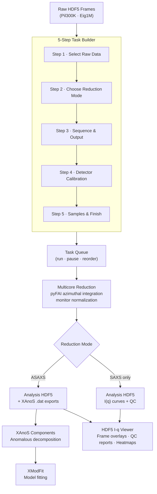

# FrameByFrame

**FrameByFrame** is a GUI-driven data reduction platform for synchrotron SAXS, WAXS, and ASAXS experiments. It turns raw detector frames into analysis-ready I(q) curves through a guided five-step wizard, then links directly to XAnoS for anomalous scattering decomposition and XModFit for model fitting.

---

## Installation

Clone the repository and install into your conda environment with an editable install:

```bash
pip install -e .
```

Then launch the application with:

```bash
FrameByFrame
```

Wizard settings are persisted automatically between sessions.

---

## End-to-End Workflow



---

## 5-Step Task Builder

Click **New Task** on the dashboard to open the task builder. Navigate with **Back** and **Next**; click **Add to Queue** on the last step to submit.

### Step 1 — Select Raw Data

Browse to or paste an experiment folder path. The app scans it automatically and reports how many `.h5` frame files are present per detector. Individual HDF5 files can also be selected manually when the folder convention does not apply.

**Detector Mode** controls which detector pipelines run: Pil300K only (SAXS), Eig1M only (WAXS), or both simultaneously.

---

### Step 2 — Choose Reduction Mode

Select the card that matches your experiment:

| Mode | When to use |
|------|-------------|
| **ASAXS / XAnoS** | Anomalous SAXS: data collected at 3+ energies near an element's absorption edge. FrameByFrame reduces all energies and exports XAnoS-format `.dat` files for component extraction. |
| **SAXS Only** | Single-energy SAXS or WAXS. Standard azimuthal integration with background subtraction and optional absolute scaling. |

A **Task Name** field at the top of this step names the queue entry.

---

### Step 3 — Sequence & Output

Set the acquisition geometry using the **Energies**, **Groups**, and **Frames** spinboxes. A live summary below them recomputes the total expected frame count as you type.

**Monitor normalization PV** — choose the beamline intensity monitor channel for flux normalization. Click *Scan PVs from HDF5* to read available PV keys directly from a sample file.

**Output folder** is derived automatically from the raw data location. Override it only when saving results elsewhere.

---

### Step 4 — Detector Calibration

Set a **PONI file** and **Mask file** for each active detector. The PONI file encodes beam center, sample-detector distance, and detector tilt; the mask excludes dead pixels, beamstop shadow, and module gaps.

**Common settings** — sample and glassy-carbon capillary thickness (used for transmission correction and absolute calibration), and the CPU core budget for parallel reduction.

---

### Step 5 — Samples & Finish

Assign sequence group numbers to their physical roles (GC, Air, Empty). Then define **sample / solvent pairs**: each row names one output file and maps a sample group to its solvent background group.

**Visual Rack Builder** — opens a graphical capillary rack layout where you drag and assign roles to physical positions. Assignments feed back into the pair table automatically.

Click **Add to Queue** to submit the task.

---

## Task Queue

Tasks appear as rows showing name, status, detector configuration, sequence geometry, and number of pairs. They can be added, edited, reordered, and removed while the queue is running.

Progress shows per-detector frame counts (Pil300K and Eig1M independently) and a smoothed ETA. Reduction runs multicore — one process pool job per (energy, group) pair, so 15 energies × 6 groups schedules 90 parallel jobs per detector.

When a task completes, a **Reduction Complete** dialog offers to open the result directly in **XAnoS Components** (ASAXS tasks only).

---

## Live I(q) Preview

The right panel of the dashboard plots I(q) curves for the selected task as it runs. Selecting a completed task loads its final curves from the analysis HDF5.

- Click to plot one curve; Ctrl-click to overlay multiple; Shift-click to select a range.
- Axes use log-q / log-I by default with interactive zoom and coordinate readout.
- **Auto-refresh** keeps the curve list current without disturbing manually selected plots.

---

## Tools Menu

The **Tools** menu at the top of the dashboard opens additional utilities without leaving the application.

### HDF5 I(q) Viewer

A full-featured curve viewer for analysis HDF5 files. Tabs cover single frames, group averages, final curves, and Frame Stability QC. Single-frame view modes include latest frame, a specific frame, the last N frames, all frames in a group, average overlaid with individual frames, and a heatmap of frame index versus q.

Navigate between energies and groups using the selectors and arrow buttons, or use Alt ← / Alt →.

### Frame Stability QC Tab

Automatically computed before each group average and loaded from the analysis HDF5 without re-opening raw data. The report includes frame overlays, I_i(q)/I_1(q) ratio heatmap, invariant-like and low-q intensity ratios, reduced chi-square, CorMap longest-run probability, optional Guinier Rg / I(0) and peak trends, and an advisory label (Good / Acceptable / Bad).

### HDF5 Structure Viewer

Browses the internal tree of any HDF5 file — datasets, attributes, shapes, and dtypes. Useful for inspecting provenance records and verifying reduction output structure.

### pyFAI PONI / Mask Setup

Launches the pyFAI calibration workflow directly from the GUI. Load a calibrant image (e.g. AgBH), run the geometry fit, then draw and save a pixel mask. Calibration files produced here are used directly in Step 4 of the task builder.

### Online 1-D Reducer

A live reduction window that receives detector frames over ZMQ as the beamline acquires data, performs azimuthal integration immediately on each incoming frame, and displays I(q) curves in real time. SAXS, WAXS, and stitched views are available as separate tabs. On plan stop, reduced curves are exported automatically to the canonical Extracted folder.

---

## Downstream Integration

### XAnoS Components

For completed ASAXS tasks, FrameByFrame launches XAnoS Components in a separate process and forwards the exported `.dat` files automatically. The handoff is triggered from the **Reduction Complete** dialog at the end of a task, or from the task context menu at any time after completion. XAnoS performs anomalous decomposition and produces element-specific I(q) components.

### XModFit

From within XAnoS Components, saving the decomposed results forwards them to XModFit in a third isolated process for model fitting, parameter optimization, and publication-quality plots.

---

## Output Files

| File | Contents |
|------|----------|
| `<sample>_analysis.h5` | Reduced I(q) curves, propagated uncertainty, frame-stability QC, reduction timing, full provenance |
| `<sample>_<energy>.dat` | XAnoS-compatible text export for ASAXS decomposition |
| `settings.json` | Wizard state — reloaded automatically on next launch |
